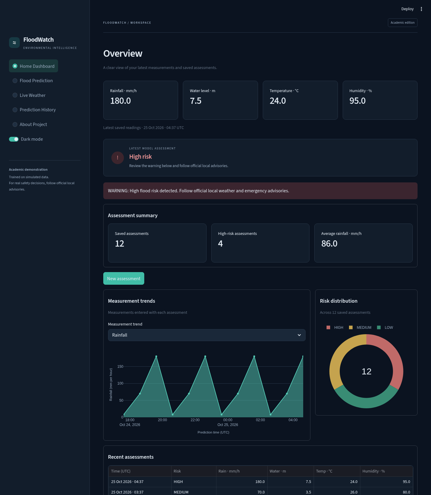

# AI-Based Smart Flood Prediction and Alert System

A beginner-friendly college project built as one Streamlit application. The dashboard
uses a genuinely trained Random Forest, SQLite history, Plotly charts and real
Open-Meteo weather integration. No API key or paid service is needed.

**Academic proof of concept — trained on SIMULATED DATA.** Predictions are not validated
real-world flood forecasts. Follow official local weather and emergency advisories.

## Run on Windows

Install standard 64-bit Python 3.12 or 3.14, then open a terminal inside this project folder:

```bat
python -m venv venv
venv\Scripts\activate
python -m pip install -r requirements.txt
python train_model.py
python -m streamlit run app.py
```

The activation command above works in Command Prompt. In PowerShell use
`venv\Scripts\Activate.ps1`; if activation is restricted, invoke
`venv\Scripts\python.exe -m pip install -r requirements.txt`, then
`venv\Scripts\python.exe train_model.py` and
`venv\Scripts\python.exe -m streamlit run app.py` directly.
Open the local browser address printed by Streamlit. Stop with Ctrl+C.
Python 3.14 compatibility has been tested on Linux; 64-bit Windows Python 3.14 dependency
wheels were also successfully resolved and downloaded. Actual Windows execution has
not been tested in this cloud environment. See the compatibility results below.

The supplied model was trained with scikit-learn 1.8.0. Retraining after installation
is recommended, especially if changing library versions. Load only trusted Joblib
model files: pickle-based artifacts can execute code.

Linux/macOS equivalent:

```sh
python3 -m venv venv
source venv/bin/activate
python -m pip install -r requirements.txt
python train_model.py
python -m streamlit run app.py
```

## Demonstration for your review

1. Start with Home Dashboard. It explains that no history exists initially.
2. Open Flood Prediction. Click **Normal Conditions**, then **Predict Flood Risk**:
   expect LOW and a green status message.
3. Repeat with **Moderate Rainfall** (MEDIUM/yellow) and **Heavy Rainfall** (HIGH/red).
   Scenario buttons populate fields only; the saved model always makes the prediction.
4. Visit Home Dashboard to see the latest readings, rainfall chart and recent records.
5. Visit Prediction History to show persisted warnings, risk distribution and rainfall
   history. Clearing history requires ticking the explicit confirmation box.
6. Visit Live Weather, choose a city and refresh. When network access works, use the
   weather transfer button, enter the local water level, tick its confirmation, and predict.
   If the API is blocked, the page shows an error; manual prediction still works.
7. Visit About Project to explain the system and show actual evaluation metrics.

## How the machine learning works

A suitable public dataset must contain compatible rainfall, water level, temperature,
humidity and documented flood labels. Public UCI catalog lookups were attempted during setup. Initial access was blocked;
after enabling access, the attempted API endpoint returned HTTP 404 and the catalog
page did not establish a suitable dataset. No compatible public dataset was verified
or downloaded. Rather than claim public evidence, this project uses a reproducible
simulated dataset generated by `train_model.py` (4,500 rows, seed 42).

Every CSV row is marked **SIMULATED DATA**. The teaching score is:

```
score = rainfall / 100 + water_level / 3
        + 0.25 if humidity >= 85
        + 0.10 if temperature <= 25
```

The supporting terms are added individually. Score below 1.5 is LOW, from 1.5 to
below 3.2 is MEDIUM, and 3.2 or higher is HIGH. These are **educational assumptions,
not scientifically verified thresholds**. Rainfall represents an hourly depth in mm;
water level is meters relative to an imaginary local reference. The rainfall examples
include unusually intense storms and should not be interpreted as normal conditions.

A stratified 75%/25% train/test split produces 3,375 training and 1,125 test rows.
A 160-tree Random Forest learns these labels. It consumes the same four raw numeric
columns at training and prediction; trees do not require feature scaling. The app does
not apply the labeling rules at prediction time.

The supplied model's holdout accuracy is **95.56%**. Its classification report and
confusion matrix are saved in `data/model_metrics.json` and displayed on About Project.
This accuracy measures agreement with synthetic rules. It establishes neither real-world
accuracy nor lead time, geographic validity or emergency reliability. Temperatures outside
the training range of 10–45°C and humidity below 20% are accepted but outside training coverage.

## Weather data and units

`weather.py` requests Open-Meteo's public forecast endpoint for fixed city coordinates:
Chennai, Mumbai, Bengaluru, Hyderabad and Kolkata. It displays temperature, relative
humidity, rain and weather code plus a two-day hourly rain forecast. API times use
Asia/Kolkata (IST); saved prediction timestamps use UTC.

Open-Meteo weather is model-derived, not a local physical sensor reading. Current rain
covers the API's `interval` (normally 900 seconds). The prediction transfer converts it
to an **equivalent hourly rate** by multiplying by `3600 / interval`. This extrapolation
is shown explicitly and is not an observed hourly accumulation. Water level must be
entered manually and confirmed. Transferred values outside form limits disable the
transfer button. Edited fields are user-entered overrides. No fake weather is substituted.

Requires outbound HTTPS to `api.open-meteo.com`. Requests have a 20-second timeout;
network/HTTP/invalid-response failures show a message. The refresh button reruns the
real API request. No weather data is silently cached or fabricated.

## Files

| File | Purpose |
| --- | --- |
| `app.py` | Five-page Streamlit dashboard and prediction input validation |
| `train_model.py` | Simulated dataset generator, training, evaluation and scenarios |
| `database.py` | Automatic SQLite initialization, saving, reading and clearing |
| `weather.py` | Real weather API request and weather descriptions |
| `flood_model.pkl` | Trained Random Forest artifact |
| `data/flood_data.csv` | Explicitly simulated training data |
| `data/model_metrics.json` | Real holdout evaluation results |
| `predictions.db` | Automatically created local history; intentionally Git-ignored |
| `test_project.py` | Model, SQLite, API handling and dashboard interaction tests |
| `.streamlit/config.toml` | Navy/white/cyan styling and disabled usage telemetry |

SQLite stores ID, UTC timestamp, all four inputs, predicted category, alert message and
input source. It is local to the project folder and persists across application restarts.
The delivered database starts empty, avoiding fabricated history.

## Tests and troubleshooting

```sh
python -m unittest -v
```

Tests use temporary databases and mocked API responses/failures. They do not erase your
history. They verify the three model categories, SQLite persistence and deletion,
Streamlit navigation, scenario prediction, weather transfer and error display.
Mocked API tests do not prove live service access. Separate real requests succeeded for
all five cities, each returning current weather and 48 hourly forecast records. Initial
network denial was resolved after adding `api.open-meteo.com` to the environment draft.
`archive.ics.uci.edu` was also added for public-dataset research. Review/save these
settings and publish the environment to retain its configuration for future tasks.

If a model is missing or incompatible, run `python train_model.py` and restart Streamlit.
If dependencies are missing, use the virtual environment's Python to install requirements.
Keep the project in a writable directory so SQLite can create and update its database.

## New dashboard improvements

- **City search:** on Live Weather expand “Search for another city”, enter a name,
  click Search cities, then choose the correct region/country from Matching locations.
  Uncheck “Use this searched location” to return to the original five quick picks.
  Search uses Open-Meteo geocoding (`geocoding-api.open-meteo.com`), with no key required.
  Weather times still use IST, including for cities outside India.
- **CSV export:** Prediction History now offers Download prediction history (CSV).
  The export includes all saved readings, UTC timestamps, categories, alerts and sources.
- **Feature importance:** About Project shows the loaded forest's actual feature
  importances. These reflect synthetic training patterns, not individual explanations
  or real-world causal influence. No retraining or new dependencies are needed.

To update an existing Windows copy, stop Streamlit with Ctrl+C and back up the folder.
Download the latest GitHub ZIP and copy `app.py`, `weather.py`, `test_project.py` and
`README.md` into your existing project folder. Preserve `predictions.db` to keep your
history. Activate your existing virtual environment and restart with
`python -m streamlit run app.py`.

## Python 3.14 compatibility results

Validated on Python **3.14.7**, standard CPython on Linux, using the unchanged
`requirements.txt`. Python 3.14.8 was unavailable from the runtime installer here;
that exact patch release has not been executed.

| Check | Result |
| --- | --- |
| Fresh virtual environment and dependency installation | Passed |
| `python -m pip check` | Passed; no broken requirements |
| Loading the supplied model and three sample scenarios | Passed |
| Retraining and saving/loading the model under Python 3.14 | Passed; simulated holdout accuracy 95.56% |
| All 10 tests including Streamlit interactions, history filters and SQLite cleanup | Passed on Python 3.14.7 and 3.12.14 |
| Streamlit server startup and local health response | Passed on Python 3.14.7 |
| Python 3.14 64-bit Windows dependency wheels | All dependencies successfully resolved and downloaded |

The same Windows setup commands above apply. There is no need to downgrade Python
solely because it is version 3.14. If you already created a virtual environment with
a different Python version, create a fresh virtual environment with your chosen version;
virtual environments are not transferred between computers or Python installations.
The database helpers now explicitly close SQLite connections after each operation,
avoiding resource warnings on newer Python and reducing file-lock issues on Windows.

## Dashboard redesign

The interface now uses a restrained teal, charcoal and off-white palette, compact
navigation, consistent typography and borders, and a clearer hierarchy across all
five pages. Home Dashboard combines the latest measurements, risk summary, rainfall
trend, risk distribution and a concise recent-history table. Empty history includes
a working first-assessment button. HIGH-risk assessments still display an explicit
warning. All charts and counts use saved history; no demo records are inserted into
the delivered database.

**Updating an existing installation:** stop Streamlit, back up your project, and copy
`app.py`, **`styles.css`**, and `.streamlit/config.toml` from the latest GitHub download
into the matching locations in your existing folder. If you missed earlier updates,
also copy `weather.py`, `database.py`, `test_project.py` and `README.md`. Preserve
`predictions.db` and your virtual environment. Restart Streamlit to load the theme.
No additional dependencies or retraining are needed.



Design preview uses simulated scenarios in an isolated preview database. Those records
are not included in your application history.

## Dark mode and dashboard tools

The application now opens in dark mode. Use **Dark mode** in the sidebar to switch
between dark and light content themes for the current session. A new session starts
in dark mode. The native Streamlit table header keeps its configured dark appearance.

Home Dashboard now includes saved-assessment and high-risk counts, average rainfall,
a New assessment shortcut, and a Measurement trend selector for rainfall or water level.
Summary counts use your actual saved history, not weather forecasts or seeded examples.
Prediction History supports risk and UTC date filters. Its table, charts and CSV export
all use the filtered records. Invalid date ranges and empty matches are explained.
The confirmed Clear demo history action still clears **all** saved history, regardless
of the active filters.

Weather import and scenario buttons now initialize explicit form values from durable
measurements rather than relying on hidden widget state. This fixes browser forms
showing input minimums (such as -10°C) after a weather transfer. A real Open-Meteo to
browser transfer was verified, along with theme switching and mobile layout.

**Update:** stop Streamlit with Ctrl+C, back up your folder, then replace `app.py`,
`styles.css`, `test_project.py`, `README.md`, and `.streamlit/config.toml` using the latest
GitHub ZIP. Keep your `venv`, `predictions.db`, dataset and trained model. Restart with
`python -m streamlit run app.py`. Dependencies are unchanged; no retraining is required.
All 10 tests pass on Python 3.12.14 and Python 3.14.7 in Linux. Windows runtime execution
remains untested here.
